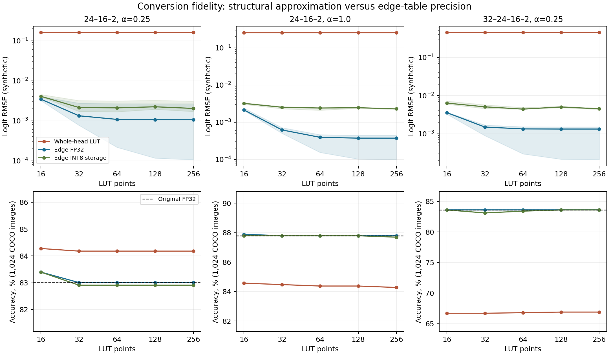

# Conversion-fidelity pilot: measured results

The predeclared synthetic gate passed on all three saved checkpoints and all three input seeds. The image results below are an exploratory paired conversion audit. They do not reproduce the old Micro tables and do not establish an MCU speed or energy advantage.

Figure: top panels show median RMSE and the min–max range over three synthetic input seeds (the bands are not confidence intervals). Bottom panels show accuracy on the same 1,024 images for each checkpoint. Post hoc anchored controls are tabulated separately.

## Image result: 1,024 evaluation images

Calibration uses 256 separate images; evaluation is balanced (512 per class). All variants receive the same FP32 MobileNet/projector features. The primary resolution is 256 points per edge.

| Model | Original FP32 accuracy | Old whole LUT, 16 | Old whole LUT, 256 | Edge FP32, 256 | Edge INT8 storage, 256 |
|---|---:|---:|---:|---:|---:|
| 24–16–2, α=0.25 | 83.008% | 84.277% | 84.180% | 83.008% | 82.910% |
| 24–16–2, α=1.0 | 87.793% | 84.570% | 84.277% | 87.793% | 87.695% |
| 32–24–16–2, α=0.25 | 83.594% | 66.699% | 66.895% | 83.594% | 83.594% |

Accuracy is agreement with labels; fidelity is agreement with the original FP32 model. A small gain in accuracy after quantization can coexist with changed predictions and is not evidence of exact conversion.

| Model | Edge FP32 disagreement | Edge INT8 disagreement | Edge INT8 Δ accuracy (pp), paired 95% CI | Edge INT8 stored bytes |
|---|---:|---:|---|---:|
| 24–16–2, α=0.25 | 0/1024 (0.000%) | 1/1024 (0.098%) | -0.098 [-0.293, +0.000] | 108,768 |
| 24–16–2, α=1.0 | 0/1024 (0.000%) | 1/1024 (0.098%) | -0.098 [-0.293, +0.000] | 108,768 |
| 32–24–16–2, α=0.25 | 0/1024 (0.000%) | 0/1024 (0.000%) | +0.000 [+0.000, +0.000] | 309,088 |

INT8 describes stored table entries only. Interpolation, scaling and activations remain FP32. Reported stored bytes include table values, per-edge scales, calibration bounds and affine parameters; they exclude CNN weights, executable code and runtime memory.

## Diagnostic controls

| Model | Exact axis mean accuracy | Exact anchored additive control | Old LUT with calibrated domain, 256 | Existing layerwise converter, 32 |
|---|---:|---:|---:|---:|
| 24–16–2, α=0.25 | 84.180% | 83.008% | 84.180% | 83.887% |
| 24–16–2, α=1.0 | 84.863% | 87.793% | 84.863% | 81.641% |
| 32–24–16–2, α=0.25 | 66.895% | 83.789% | 66.895% | 75.000% |

The original whole-network transformation tends to g(x)=mean_i f(x_i e_i), not f(x). The exact-axis control removes table discretization. The anchored control f(0)+sum_i[f(x_i e_i)-f(0)] removes the mean/offset error but still cannot generally represent interactions generated by composed nonlinear layers. The old layerwise class sums whole-layer axis sections, repeating nonzero edge intercepts; the independent constant-edge test proves this even without discretization error.

### Post hoc cheaper-control check

The exact anchored control exposed a useful alternative. After the primary run, we specified FOLLOWUP_PROTOCOL.md and evaluated 30 additional derived variants, without fitting to labels. The calibrated whole-head LUT can be re-centered as d·LUT(x)−(d−1)·f(0). Its class predictions can be close to the reference while its probabilities remain different. Probability RMSE below is against the original model, not a measure of calibration to ground truth.

| Model | Anchored whole LUT, 32: disagreement | Anchored probability RMSE | Edge INT8, 32: disagreement | Edge INT8 probability RMSE |
|---|---:|---:|---:|---:|
| 24–16–2, α=0.25 | 0/1024 | 0.049545 | 1/1024 | 0.001479 |
| 24–16–2, α=1.0 | 0/1024 | 0.042901 | 0/1024 | 0.000891 |
| 32–24–16–2, α=0.25 | 2/1024 | 0.049343 | 11/1024 | 0.005741 |

This control prevents a claim that full edge compilation is always necessary for classification accuracy. The defensible distinction is numerical/probability fidelity, memory cost and behavior beyond this particular operating threshold. All resolutions of this exploratory control are retained in results/anchored_control/metrics.json.

| Model | Features outside old [-2,2] | Images with any such feature | Edge FP32 saturation per layer, 256 |
|---|---:|---:|---|
| 24–16–2, α=0.25 | 1.587% | 12.402% | 0.016%, 0.110% |
| 24–16–2, α=1.0 | 0.728% | 6.445% | 0.065%, 0.043% |
| 32–24–16–2, α=0.25 | 1.941% | 13.281% | 0.049%, 0.037%, 0.049% |

Saturation is counted on the converted trajectory at each layer. A lower saturation rate does not itself guarantee a smaller prediction error. Results for all five resolutions and the separate out-of-range synthetic stress test are retained.

## Synthetic gate

There are 297 recorded comparisons: three checkpoints, input seeds 42/43/44, five table resolutions, in-range and stress inputs, and diagnostic controls. Each seed uses 4,096 calibration, 4,096 evaluation and 4,096 stress vectors. These seeds do not represent independent training runs. Class disagreement on synthetic features is not image accuracy.

| Model | RMSE reduction, old 256 / edge FP32 256, across three seeds | Edge FP32 disagreements per 4,096 |
|---|---|---|
| 24–16–2, α=0.25 | 1530.3×, 60.8×, 152.4× | 0, 0, 0 |
| 24–16–2, α=1.0 | 2652.2×, 686.2×, 567.5× | 0, 1, 0 |
| 32–24–16–2, α=0.25 | 2161.7×, 299.6×, 340.0× | 0, 0, 0 |

The separate [0,4] stress inputs exceed the calibration interval. The edge LUT saturates there and is not globally equivalent to the original network:

| Model | Edge FP32 256: stress disagreement range across seeds | First-layer saturated values |
|---|---:|---:|
| 24–16–2, α=0.25 | 21.61–23.63% | 47.35–47.39% |
| 24–16–2, α=1.0 | 15.89–16.85% | 47.35–47.39% |
| 32–24–16–2, α=0.25 | 8.98–9.64% | 47.42–47.54% |

## Native C check

The generator emitted C99 with actual int8_t tables and FP32 arithmetic. Each 256-point INT8-storage image model was compiled with warnings treated as errors, then tested on the same 1,024 feature vectors. Acceptance required allclose(atol=2e-5, rtol=2e-5) and zero changed class decisions relative to the Python table evaluator.

| Model | Maximum C/Python logit difference | Changed decisions | Explicit two activation buffers |
|---|---:|---:|---:|
| 24–16–2, α=0.25 | 1.19e-06 | 0 | 192 B |
| 24–16–2, α=1.0 | 9.54e-07 | 0 | 192 B |
| 32–24–16–2, α=0.25 | 9.54e-07 | 0 | 256 B |

The two arrays are not a measurement of total stack or MCU SRAM. CPU head-only timings are archived in native_checks.json, but no speedup claim is made from them.

## Validation and limitations

- Ten mathematical/implementation tests pass. Independent saved-array verification recalculates 297 synthetic and 75 image rows, including paired error counts and Wilson intervals; 30 post hoc derived rows are also recalculated.
- All three full checkpoints load strictly. Original weights and conversion source are unchanged. No retraining or selection by pilot accuracy was performed.
- The historical 16–4–2 checkpoints and exact 6,000-image manifests are absent. The selected models are 24–16–2 and 32–24–16–2.
- Evaluation IDs are in the repository minival list and disjoint from this pilot's calibration IDs. Their possible use for historical checkpoint selection is unknown. Bootstrap intervals measure image sampling only, not training uncertainty or generalization to a new deployment.
- A [0,0] paired-bootstrap interval when all observed paired differences are zero is a degenerate empirical bootstrap result, not proof of zero population error or equivalence. Likewise, zero class changes in 1,024 images is an observed count, not a universal guarantee.
- No physical MCU, fully INT8 activation path, TFLite graph, energy measurement or matched MLP comparison was run. Symbolic edges, multiplication nodes and remapped inputs are explicitly rejected by this pilot implementation.

## Decision for the article

Proceed to a bounded hardware validation, subject to obtaining the exact old checkpoints and locked data. The defensible candidate result is that a small executable conversion can silently change the learned function, and that separating structural approximation, clipping, table precision and runtime arithmetic exposes the cause. Per-edge LUT compilation itself is prior work. See PRIOR_WORK.md for six related publications and the proposed boundary of the revised article.

Next experiment: carry identical model parameters and golden feature vectors to ESP32-S3; compare original-converter and layer-preserving paths at common memory budgets; measure head-only and full CNN+head latency, Flash, peak SRAM/PSRAM and energy, with a matched MLP. Use the exact old 16–4–2 model as the bridge to the rejection, plus these two topologies.

## Complete image sweep

| Model | Points | Old accuracy | Edge FP32 accuracy | Edge INT8 accuracy | FP32 disagreement | INT8 disagreement | INT8 bytes |
|---|---:|---:|---:|---:|---:|---:|---:|
| 24–16–2, α=0.25 | 16 | 84.277% | 83.398% | 83.398% | 0.586% | 0.781% | 8,928 |
| 24–16–2, α=0.25 | 32 | 84.180% | 83.008% | 82.910% | 0.000% | 0.098% | 15,584 |
| 24–16–2, α=0.25 | 64 | 84.180% | 83.008% | 82.910% | 0.000% | 0.293% | 28,896 |
| 24–16–2, α=0.25 | 128 | 84.180% | 83.008% | 82.910% | 0.000% | 0.098% | 55,520 |
| 24–16–2, α=0.25 | 256 | 84.180% | 83.008% | 82.910% | 0.000% | 0.098% | 108,768 |
| 24–16–2, α=1.0 | 16 | 84.570% | 87.891% | 87.793% | 0.098% | 0.000% | 8,928 |
| 24–16–2, α=1.0 | 32 | 84.473% | 87.793% | 87.793% | 0.000% | 0.000% | 15,584 |
| 24–16–2, α=1.0 | 64 | 84.375% | 87.793% | 87.793% | 0.000% | 0.000% | 28,896 |
| 24–16–2, α=1.0 | 128 | 84.375% | 87.793% | 87.793% | 0.000% | 0.195% | 55,520 |
| 24–16–2, α=1.0 | 256 | 84.277% | 87.793% | 87.695% | 0.000% | 0.098% | 108,768 |
| 32–24–16–2, α=0.25 | 16 | 66.699% | 83.594% | 83.594% | 0.195% | 0.000% | 24,928 |
| 32–24–16–2, α=0.25 | 32 | 66.699% | 83.594% | 83.105% | 0.195% | 1.074% | 43,872 |
| 32–24–16–2, α=0.25 | 64 | 66.797% | 83.594% | 83.398% | 0.000% | 0.391% | 81,760 |
| 32–24–16–2, α=0.25 | 128 | 66.895% | 83.594% | 83.594% | 0.000% | 0.000% | 157,536 |
| 32–24–16–2, α=0.25 | 256 | 66.895% | 83.594% | 83.594% | 0.000% | 0.000% | 309,088 |
